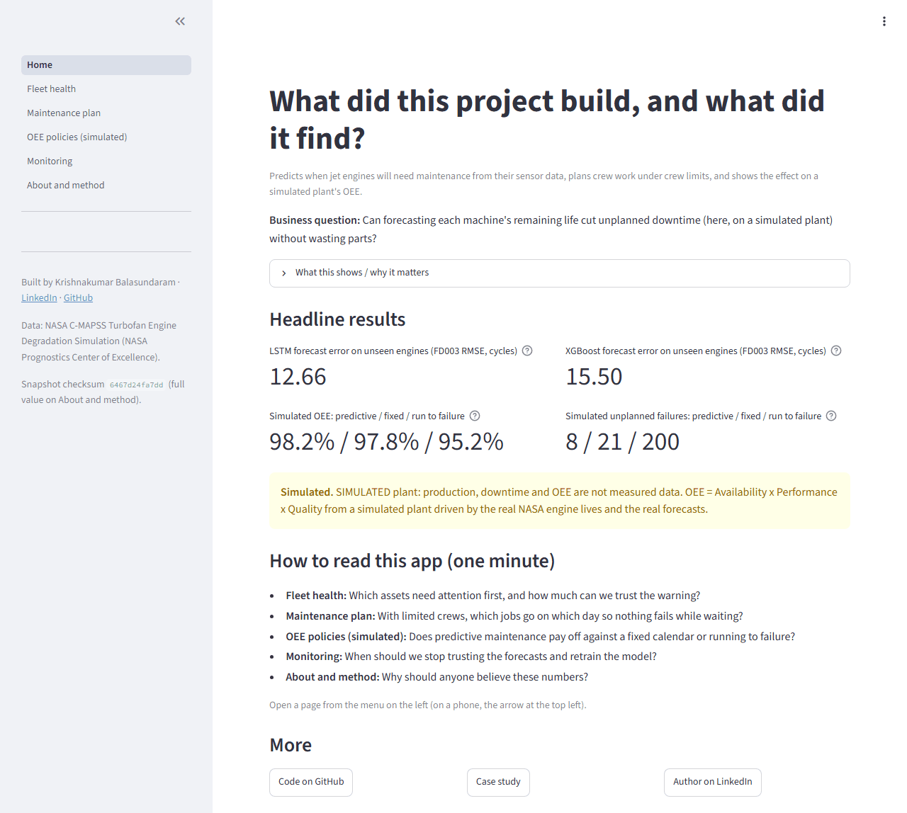
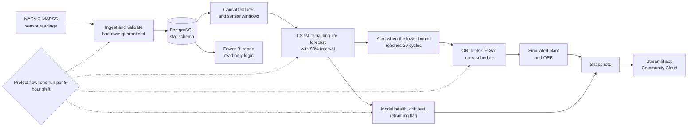

# Predictive Maintenance & OEE

Predicts when jet engines will need maintenance from their sensor data, then plans crew work so engines are serviced before they fail.

[](https://github.com/krishna6116/Predictive-Maintenance-OEE/actions/workflows/ci.yml) [](https://www.python.org/) [](LICENSE) [](https://predictive-maintenance-oee.streamlit.app)

**TL;DR**

- **Problem:** unplanned equipment failures stop production; fixed service schedules throw away useful life.
- **Built end to end:** data pipeline into PostgreSQL, remaining-life forecasts with uncertainty, a crew scheduler, a shift-by-shift monitoring flow, and dashboards (Streamlit and Power BI), every result checked by independent code in CI.
- **Forecast:** the published LSTM model's error on unseen NASA engines (FD003) is 12.66 cycles (RMSE) against 15.50 for XGBoost.
- **Simulated plant, 200 machines:** OEE 98.2% with predictive maintenance vs 97.8% fixed interval vs 95.2% run to failure; unplanned failures 8 / 21 / 200 (simulated).
- **Live app:** https://predictive-maintenance-oee.streamlit.app (free hosting; if it shows a sleep page, click the wake-up button and wait about a minute)

**Tech stack:** Python · PostgreSQL · pandas · scikit-learn · XGBoost · PyTorch (LSTM, 1D-CNN) · OR-Tools CP-SAT · Prefect · Streamlit · Power BI · pytest · GitHub Actions



## Results at a glance

| What | Result | Compared with |
| --- | --- | --- |
| Remaining-life error, unseen FD003 engines (RMSE, cycles; lower is better) | **LSTM 12.66** | XGBoost 15.50, age-only rule 33.94 |
| Error near failure (mean absolute error on engines near failure, see [glossary](docs/GLOSSARY.md); FD001 + FD003) | **2.76 cycles** | XGBoost 4.60 cycles |
| Published 90% interval: share of FD003 engines whose true remaining life falls inside | **86%** | 100% of engines near failure |
| Simulated OEE: predictive / fixed interval / run to failure | **98.2%** / 97.8% / 95.2% | predictive minus fixed +0.37 percentage points (95% interval +0.19 to +0.56, simulated) |
| Simulated unplanned failures: predictive / fixed interval / run to failure | **8** / 21 / 200 | every simulated machine fails under run to failure |

Every number on this page is generated from the results files and re-checked by independent code on every push. Full results with intervals and sources: [docs/RESULTS.md](docs/RESULTS.md).

## Business impact (simulated)

What the maintenance policies mean in operations terms, on the same 200 simulated machines (counts and hours only; no real cost data was available):

| Simulated outcome | Predictive | Fixed interval | Run to failure |
| --- | --- | --- | --- |
| Unplanned failures (simulated) | **8** | 21 | 200 |
| Planned services (simulated) | 192 | 179 | 0 |
| Downtime, hours (simulated) | **1,920** | 2,440 | 9,600 |
| Useful life thrown away at early services, cycles (simulated) | **4,843** | 12,989 | 0 |

In the simulated plant, predictive maintenance avoids 13 unplanned failures compared with a fixed service interval and 192 compared with run to failure, while the fixed interval throws away 2.7 times as much useful engine life. The crew plan respects 3 crews a day: on FD001 it books 21 of the 23 flagged engines into the 7-day horizon.

## How it works



Architecture, star schema and technology choices: [docs/ARCHITECTURE.md](docs/ARCHITECTURE.md).

## What makes this trustworthy

- **Decided before seeing results:** model choices, statistical tests, monitoring rules and every phase's success criteria were committed before the test data was scored ([decision log](docs/DECISIONS.md)).
- **Validation only:** models were chosen on validation engines; the test set only confirms.
- **Fair comparisons:** every model is compared with simple baselines on the same engines, with paired bootstrap intervals and Holm correction for multiple tests.
- **Confirmed on fresh data:** the switch from XGBoost to the LSTM was tested on a dataset (FD003) that nothing had seen, with every setting frozen.
- **Independent verifiers in CI:** each phase has a separate script that recomputes its published numbers with different code; CI runs them on every push.
- **Misses reported, not re-tuned:** Phase 7's drift test raised false alarms on 11.6% of clean test runs against a 5% target (not met). Phase 7b's new rule failed its pre-registered criterion C1 on FD004: 19.5% and 13.9% of clean runs flagged (synchronized and staggered fleets) against a 5% limit. Both are reported, not re-tuned.

## Skills demonstrated

| Job function | What this project shows | Proof |
| --- | --- | --- |
| Data engineering | PostgreSQL star schema, validation with a quarantine table, idempotent run-ID loads | [pipeline/schema.sql](pipeline/schema.sql) · [pipeline/validate.py](pipeline/validate.py) · [pipeline/load.py](pipeline/load.py) |
| Machine learning | XGBoost and Ridge baselines, PyTorch LSTM and 1D-CNN, Monte Carlo dropout uncertainty | [models/baselines.py](models/baselines.py) · [models/deep.py](models/deep.py) |
| Statistics | Engine-level bootstrap, paired tests, Holm correction, KS drift tests | [models/metrics.py](models/metrics.py) · [models/run_fd003.py](models/run_fd003.py) · [pipeline/monitoring.py](pipeline/monitoring.py) |
| Operations research | Crew scheduling with OR-Tools CP-SAT, optimality proved by a second method | [maintenance/schedule.py](maintenance/schedule.py) |
| MLOps | Prefect shift flow with retries and resume, drift and retraining rules, CI verification | [pipeline/flow.py](pipeline/flow.py) · [pipeline/monitoring2.py](pipeline/monitoring2.py) · [.github/workflows/ci.yml](.github/workflows/ci.yml) |
| BI and dashboards | Streamlit app on frozen snapshots, Power BI on the star schema, both checked against independent numbers | [app/streamlit_app.py](app/streamlit_app.py) · [docs/DASHBOARDS.md](docs/DASHBOARDS.md) |
| Operations and quality | OEE (availability x performance x quality) and maintenance-policy comparison on a simulated plant | [maintenance/simulate.py](maintenance/simulate.py) · [docs/MAINTENANCE_OEE.md](docs/MAINTENANCE_OEE.md) |

## Progress

| Phase | Status | Read more |
| --- | --- | --- |
| 0. Setup: structure, tests, CI | Done | [CI workflow](.github/workflows/ci.yml) |
| 1. Exploratory data analysis | Done | [EDA findings](docs/EDA_FINDINGS.md) · [notebook](notebooks/01_eda.ipynb) |
| 2. Data pipeline: PostgreSQL star schema, validation and quarantine, idempotent loads | Done | [Pipeline](docs/PIPELINE.md) |
| 3. Feature engineering: engine-level split, causal features, incremental builds | Done | [Features](docs/FEATURES.md) · [notebook](notebooks/03_features.ipynb) |
| 4. Baseline models: fleet average, age-only, Ridge, XGBoost | Done | [Model metrics](docs/MODEL_METRICS.md) · [notebook](notebooks/04_baselines.ipynb) |
| 5. Deep learning: LSTM and 1D-CNN, Monte Carlo dropout intervals | Done | [Deep models](docs/MODEL_METRICS_PHASE5.md) · [notebook](notebooks/05_deep.ipynb) |
| 5b. Confirmation on a fresh dataset (FD003) with pre-registered tests | Done | [Confirmation](docs/MODEL_METRICS_PHASE5B.md) · [notebook](notebooks/05b_fd003.ipynb) |
| 6. Alerts, CP-SAT crew schedule, simulated plant and OEE, three-policy comparison | Done | [Maintenance and OEE](docs/MAINTENANCE_OEE.md) · [notebook](notebooks/06_maintenance.ipynb) |
| 7. Prefect shift flow, model health, drift and retraining rules | Done | [Monitoring](docs/MONITORING.md) · [notebook](notebooks/07_monitoring.ipynb) |
| 7b. Monitoring re-tested on unseen FD002/FD004 (one criterion failed on FD004, reported) | Done | [Phase 7b](docs/MONITORING_7B.md) · [notebook](notebooks/07b_monitoring.ipynb) |
| 8. Dashboards: deployed Streamlit app and Power BI report | Done | [Dashboards](docs/DASHBOARDS.md) · [live app](https://predictive-maintenance-oee.streamlit.app) |
| 9. Write-up: README, case study, results, architecture, decisions, release | Done | [Docs index](docs/README.md) · [case study](docs/CASE_STUDY.md) |

## Repository map

```text
app/            Streamlit app (reads frozen snapshots only)
dashboards/     snapshots, Phase 8 verifier, Power BI theme and read-only login
data/           NASA files (downloaded, not committed) and their checksums
docs/           write-up, phase docs, figures (start at docs/README.md)
features/       causal feature engineering and the engine-level split
maintenance/    alerts, CP-SAT crew schedule, simulated plant and OEE
models/         baselines, LSTM/CNN, calibration, results files
notebooks/      one notebook per phase, built by scripts in the same folder
pipeline/       ingest, validation, PostgreSQL loads, Prefect flow, monitoring
results/        Phase 7 and 7b monitoring results
scripts/        screenshot capture and the optional keep-awake visit
tests/          pytest suite
writeup/        Phase 9: facts, renderer, verifier and scorecard
.github/        CI workflows
```

## Run locally

Python 3.14 (the version CI uses). `requirements-lock.txt` pins every package to the versions behind the published results; the first line installs the smaller CPU-only PyTorch build.

Windows (PowerShell):

```powershell
python -m venv .venv
.\.venv\Scripts\Activate.ps1
pip install torch==2.14.1 --index-url https://download.pytorch.org/whl/cpu
pip install -r requirements-lock.txt
pytest -q
```

macOS / Linux (bash):

```bash
python -m venv .venv
source .venv/bin/activate
pip install torch==2.14.1 --index-url https://download.pytorch.org/whl/cpu
pip install -r requirements-lock.txt
pytest -q
```

The full pipeline (PostgreSQL, Prefect, dashboards) is described in [docs/ARCHITECTURE.md](docs/ARCHITECTURE.md).

## Data

NASA C-MAPSS Turbofan Engine Degradation Simulation (A. Saxena and K. Goebel, NASA Prognostics Center of Excellence, 2008): four datasets, FD001-FD004, each with training engines run to failure and test engines that stop before failure. One command downloads them and checks every file against the SHA-256 checksums in `data/checksums.sha256`, so results are always reproduced on byte-identical data. Data files are not committed.

```bash
python -m pipeline.download_data
```

## Continuous verification

Every push runs these GitHub Actions jobs ([ci.yml](.github/workflows/ci.yml)):

- **test**: installs the pinned packages and runs the test suite.
- **verify**: downloads the pinned NASA data, runs the pipeline into a fresh PostgreSQL database, builds the features and runs the Phase 3, 4, 5, 5b and 6 verifiers plus the Phase 8 database checks.
- **phase7**: replays shifts of the Prefect flow in a fresh database and runs the Phase 7 and 7b verifiers.
- **dashboards**: installs only the app's pinned requirements on Python 3.12, 3.13 and 3.14 and runs the Phase 8 verifier.
- **writeup**: re-renders the write-up, checks it is unchanged and runs the Phase 9 verifier (external links are checked in a non-blocking step).
- **writeup-repro**: runs the macOS/Linux commands above, exactly as written, on a fresh machine.
- **keep-awake** (separate workflow, every 6 hours): one visit to the public app so the free host does not put it to sleep.

## Limitations and what I would do next

- **Simulated plant.** The OEE, downtime and failure figures come from a simulated plant driven by real NASA engine lives and real forecasts; they are not measured production data.
- **Monitoring failed on FD004.** The wear-adjusted drift rule flagged 19.5% and 13.9% of clean FD004 runs against a 5% limit; the likely cause is a mix of two fault modes, which is not proven.
- **Unseen data needed.** A fault-mode-aware drift reference would need data no model has seen, such as NASA's N-CMAPSS, to confirm; all four C-MAPSS test sets are already used.
- **Censored labels.** Once maintenance acts, engines are serviced before they fail, so failure labels are censored and labels-only monitoring underestimates misses; a deployment needs inspection labels or a control group.
- **No cost data.** Impact is shown in counts and hours, not money: no real cost figures were available.
- **Simulation data.** C-MAPSS itself is simulated engine data; field data would add sensor noise, gaps and maintenance records this project could not test.

## How this was built

Built phase by phase from a study guide, with Claude (Anthropic's AI assistant) as the coding assistant. The author chose the project, the phase plan and the success criteria for each phase, approved every pre-registration and publication decision, built the Power BI report, deployed the app and produced the manual evidence. The assistant wrote most of the code, tests and documentation under that direction. Every published claim is re-checked by independent verifier code in CI, so it does not depend on trusting either of us.

## Author

Krishnakumar Balasundaram · MS Business Analytics, UMass Amherst (Isenberg) · [LinkedIn](https://www.linkedin.com/in/krishnakumar-balasundaram-3a92b6422) · [GitHub](https://github.com/Krishna6116)

## License

MIT, see [LICENSE](LICENSE).
