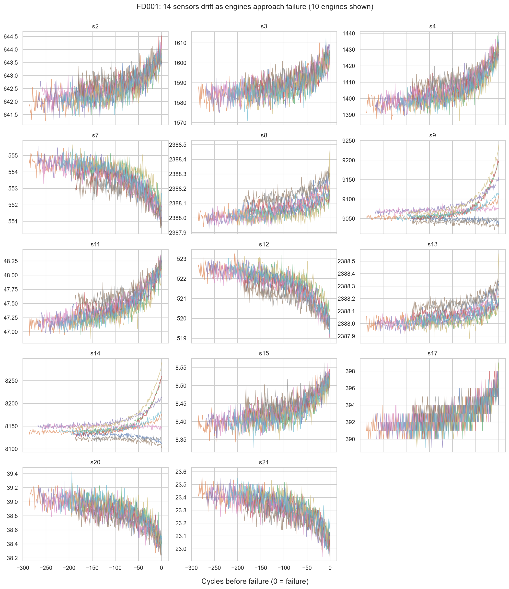

# Predictive Maintenance & OEE

Predicts turbofan engine failures from sensor data, schedules maintenance under crew limits, and shows the effect on OEE.

[](https://github.com/krishna6116/Predictive-Maintenance-OEE/actions/workflows/ci.yml)

> **Work in progress.** Phases 0-5 complete, plus a confirmation on a second NASA dataset (5b); Phase 6 (maintenance scheduling and OEE) next.

## Progress

| Phase | Status | Read more |
| --- | --- | --- |
| 0. Setup: structure, tests, CI | Done | |
| 1. Exploratory data analysis (FD001) | Done | [EDA findings](docs/EDA_FINDINGS.md) · [notebook](notebooks/01_eda.ipynb) |
| 2. Data pipeline: PostgreSQL star schema, batch ingest, validation and quarantine, idempotent run-ID loads | Done | [Pipeline design](docs/PIPELINE.md) |
| 3. Feature engineering: RUL cap, engine-level split, 168 causal features, incremental builds | Done | [Features](docs/FEATURES.md) · [notebook](notebooks/03_features.ipynb) |
| 4. Baseline models: fleet average, Ridge, XGBoost; bootstrap intervals, paired comparisons, ablations | Done | [Model metrics](docs/MODEL_METRICS.md) · [notebook](notebooks/04_baselines.ipynb) |
| 5. Deep learning: LSTM and 1D-CNN on sensor windows, MC-dropout intervals calibrated on validation | Done | [Deep model metrics](docs/MODEL_METRICS_PHASE5.md) · [notebook](notebooks/05_deep.ipynb) |
| 5b. Confirmation on FD003 (fresh test set, second fault mode): frozen recipe, pre-registered tests, better interval rule | Done | [Confirmation metrics](docs/MODEL_METRICS_PHASE5B.md) · [notebook](notebooks/05b_fd003.ipynb) |
| 6. Maintenance alerts, OR-Tools crew schedule, simulated OEE | Next | |
| 7-9. Orchestration and monitoring, dashboards, write-up | Planned | |

**Highlights so far**

- 14 of 21 sensors kept; 8 constant or two-valued inputs dropped, each with a stated reason.
- Sensors stay flat for most of an engine's life and drift in the last ~100-150 cycles, which is why remaining life is capped at 125 cycles.
- 20,631 training and 2,000 test readings loaded into PostgreSQL and verified against the NASA files cell by cell (0 mismatches). Injected faults are quarantined with a reason instead of being loaded.
- 168 features built only from past readings; smoothing lifts the median sensor's correlation with remaining life from 0.69 to 0.80. Features built per batch match a full rebuild exactly, and an independent recomputation of all 3.9 million stored feature values matches to within 2e-13 (`python -m features.verify`, 25/25 checks).
- Baseline on NASA's 100 test engines: XGBoost reaches **15.08 RMSE** (95% interval 12.2-17.9). It beats a fleet average (41.9) and an age-only rule (31.2). Near failure (50 or fewer cycles left) its mean error is **4.4 cycles**, against 13.3 for a linear model on the same features; it was chosen on validation data, and the test set confirms it. Feature engineering is the largest real gain; FFT features show no measurable effect, and that is reported. Results reproduce on any machine: XGBoost runs on one fixed thread, and CI re-trains it on Linux and checks it against the published numbers.
- Deep learning (PyTorch) on the same 100 test engines: an LSTM on 40-cycle sensor windows reaches **13.30 RMSE** (95% interval 10.5-16.1) and 3.1 cycles mean error near failure. That is better than XGBoost on paper, but the paired, Holm-corrected comparison does not exclude zero, so on FD001 alone the rule set before testing kept XGBoost. MC-dropout intervals covered only 76% of validation truths at a nominal 90%; one scale factor learned on validation brought test coverage to 82% (88% near failure).
- Confirmation on NASA FD003, a fresh dataset with a second fault mode, with every setting frozen from FD001 and the tests committed before the run: the LSTM reaches **12.66 RMSE** against XGBoost's 15.50. Pooled over 200 test engines its advantage is **2.31 cycles RMSE (95% interval 0.76-4.05, Holm p 0.007)** and 2.76 vs 4.60 cycles near failure, so **the LSTM is now the published model**. A two-factor interval rule, chosen on FD001 validation before FD003 was touched, covers 86% of FD003 test engines (100% of the 29 near failure) at a nominal 90%.



## Data

NASA C-MAPSS Turbofan Engine Degradation Simulation (A. Saxena and K. Goebel, NASA Prognostics Center of Excellence, 2008). Download it with one command; every file is checked against the SHA-256 checksums in `data/checksums.sha256`, so results are always reproduced on byte-identical data:

```powershell
python -m pipeline.download_data
```

FD001: 100 training engines (20,631 rows), 100 test engines (13,096 rows), 26 columns. Data files are not committed.

**Continuous verification:** on every push, GitHub Actions downloads the pinned data, runs the pipeline into a fresh PostgreSQL database, builds the features, and runs the test suite plus the Phase 3, 4, 5 and 5b verifiers, which recompute the published numbers with independent code.

## Run locally

```powershell
python -m venv .venv
.\.venv\Scripts\Activate.ps1
pip install -r requirements-lock.txt   # exact versions; requirements.txt lists the top-level packages
pytest -q
```
