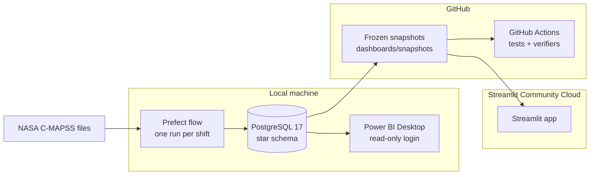

# Architecture

<!-- Generated by `python -m writeup.report_phase9` from the results files; do not edit by hand. -->

## System

## Star schema (PostgreSQL)

| Table | Grain (one row per) | Key |
| --- | --- | --- |
| `pipeline_runs` | load or shift run | `run_id` |
| `dim_engine` | engine in a dataset and split | `dataset, split, engine_id` |
| `fact_sensor_reading` | engine and cycle | `dataset, split, engine_id, cycle` |
| `quarantine` | rejected input row, with its reason | `id` |
| `fact_features` | engine and cycle (causal features) | `dataset, split, engine_id, cycle` |
| `fact_prediction` | forecast for an engine at a cycle in a run | `run_id, dataset, engine_id, cycle` |
| `fact_alert` | maintenance decision for an engine in a run | `run_id, dataset, context, engine_id` |
| `fact_oee` | simulated machine under one policy | `run_id, dataset, policy, machine_id` |
| `fact_model_health` | monitoring run (shift) | `run_id` |
| `fact_drift` | sensor drift test in a run | `run_id, sensor` |

Definitions: [pipeline/schema.sql](../pipeline/schema.sql). Loads are idempotent: each run has a fixed run ID, so re-running it replaces its rows instead of duplicating them.

## Data flow per shift

1. Ingest the readings that arrived in the shift; validate them; quarantine bad rows with a reason.
2. Load valid rows into `fact_sensor_reading` and build features for the new cycles.
3. Predict remaining life with the published model and its 90% interval (100 Monte Carlo dropout passes).
4. Flag engines whose interval's lower bound is at or below 20 cycles and schedule them with CP-SAT under 3 crews a day over a 7-day horizon.
5. Score the model on engines whose failure is already known, test every sensor for drift, and set a retraining flag when the pre-registered rule fires.

## What runs where

| Component | Where | Notes |
| --- | --- | --- |
| PostgreSQL, Prefect, model training | local machine | `.env` holds the database login (never committed) |
| Power BI report | local machine | read-only login `powerbi_ro`; the .pbip project is not committed |
| Streamlit app | Streamlit Community Cloud | reads only the committed snapshots; no database or model weights |
| Tests and verifiers | GitHub Actions | fresh PostgreSQL service container; pinned NASA data |

## Why these technologies

| Choice | Over | Why |
| --- | --- | --- |
| PostgreSQL star schema | flat CSV files | keys and foreign keys catch duplicates and orphans; Power BI reads it directly |
| XGBoost and Ridge baselines | deep models only | a deep model must beat strong simple models on the same engines to earn its place |
| PyTorch LSTM | transformer models | sequences are short; the LSTM is small, fast on a CPU and reproducible with one thread |
| Monte Carlo dropout | ensembles | uncertainty from one trained model; calibrated on validation engines |
| OR-Tools CP-SAT | greedy rules | proves the plan optimal under crew limits; a second method re-checks it |
| Prefect | cron scripts | retries, fixed run IDs and resume after failure come built in |
| Streamlit on frozen snapshots | a live database connection | free public hosting, no credentials in the cloud, numbers checkable by checksum |
| Power BI | only Streamlit | the BI tool most hiring teams use, on the same star schema |

Settings that shape the system: remaining life is capped at 125 cycles (`features/build.py`), the LSTM reads 40-cycle sensor windows, and every split is by engine.

Back to the [README](../README.md) · [docs index](README.md)
