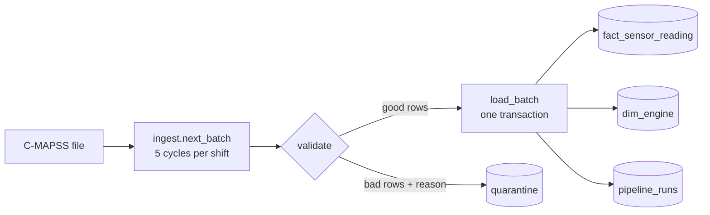

# Data pipeline (Phase 2)

Sensor readings arrive in batches (one "shift" = 5 cycles by default), are checked, and land in PostgreSQL. Bad rows are set aside with a reason, and every row can be traced to the run that wrote it.



## How to run it

```powershell
python -m pipeline.setup_env                    # once: writes .env and tests the connection
python -m pipeline.run_batch --init             # once: creates tables and sensor limits
python -m pipeline.run_batch --split train --all  # load the full training set
python -m pipeline.run_batch --next             # load the next shift of test data (repeat)
python -m pipeline.run_batch --next --inject-faults  # demo: 3 bad rows go to quarantine
```

## Tables (star schema)

| Table | Type | One row per | Key |
| --- | --- | --- | --- |
| `fact_sensor_reading` | Fact | engine per cycle | dataset, split, engine_id, cycle |
| `dim_engine` | Dimension | engine | dataset, split, engine_id |
| `quarantine` | Control | rejected row | id (plus run_id, reason, raw JSON) |
| `pipeline_runs` | Control | pipeline run | run_id |

Train and test engines reuse the same IDs (1-100), so `split` is part of every key.

## Validation rules

A row keeps the first rule it fails:

1. **missing value**: any kept column is empty.
2. **duplicate cycle**: the same engine and cycle appear twice in a batch (the first is kept).
3. **`<sensor>` out of range**: outside the training min-max widened by 10% on each side (`pipeline/sensor_limits.json`).
4. **cycle gap**: an engine skips cycles compared with the last cycle received, in this batch or an earlier run. A reading quarantined for another reason still counts as received, so one bad reading does not cascade into false gaps.

## Guarantees

- **All or nothing:** each batch loads in one transaction. If anything fails, nothing is written, and the run is recorded as `failed` with the error.
- **Idempotent:** rerunning a batch leaves the same rows. The latest delivery of an engine-cycle replaces the earlier one, and `pipeline_runs` keeps the history of every attempt.
- **Traceable:** every fact and quarantine row carries the `run_id` that wrote it.

## Why we did these tasks

| # | Task | Why we did it | What it gives us | What it changes next |
| --- | --- | --- | --- | --- |
| 1 | Designed a star schema (fact, dimension, control tables) | It is how analytics teams model data: simple joins, one place per fact, clear keys | Clean tables that BI tools and SQL can query directly | Phase 8 dashboards read these tables; Phase 3 builds features from `fact_sensor_reading` |
| 2 | Replayed the data in 5-cycle batches | Real plants deliver data continuously, not as one file; batches make the pipeline behave like production | A pipeline that can run every shift | Phase 7 schedules exactly this step with Prefect |
| 3 | Validated every batch and quarantined bad rows with a reason | Bad sensor data leads to bad maintenance calls; dropping it silently hides problems | Clean data in the fact table, and an audit trail of what was rejected and why | Model inputs stay trustworthy; quarantine counts become a pipeline-health chart |
| 4 | Set limits from the training range plus 10% | Limits must come from known-good data, with room for normal variation | Objective, documented thresholds instead of guesses | The same limits feed drift monitoring in Phase 7 |
| 5 | Loaded each batch in one transaction with a run ID | Pipelines fail and get rerun; without this, reruns duplicate data and every number downstream is wrong | Safe reruns, all-or-nothing loads, and every row traceable to its run | Predictions in Phase 5-6 can be traced back to the exact data they used |
| 6 | Added fault injection and tests (including a throwaway test schema) | You cannot trust validation you have never seen catch a fault | Proof that each rule works, run automatically in CI | Gives you a live demo for interviews: inject faults and show them quarantined |

## First live run (2026-10-17)

| Run | Cycles | Loaded | Quarantined |
| --- | --- | --- | --- |
| Training set, all engines | 1-362 | 20,631 | 0 |
| Test shift 1 | 1-5 | 500 | 0 |
| Test shift 2 | 6-10 | 500 | 0 |
| Test shift 3 | 11-15 | 500 | 0 |
| Test shift 4, with injected faults | 16-20 | 498 | 3 (1 missing value, 1 s4 out of range, 1 duplicate cycle) |
| Rerun of shift 1 | 1-5 | 500 | 0 |

After the rerun, cycles 1-5 still hold exactly 500 test rows: the rerun replaced the earlier rows instead of duplicating them. The real NASA data produced no quarantined rows; only the injected faults were caught.
